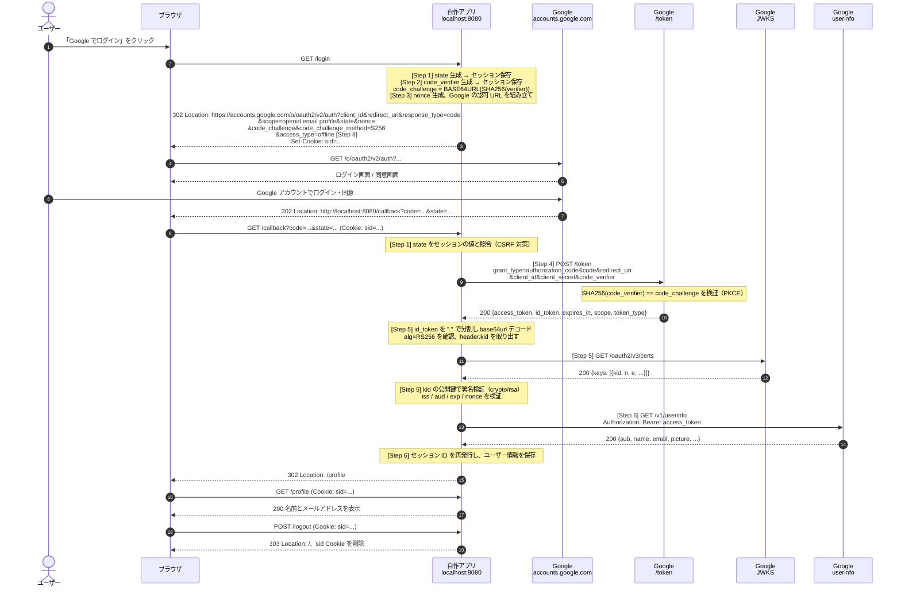
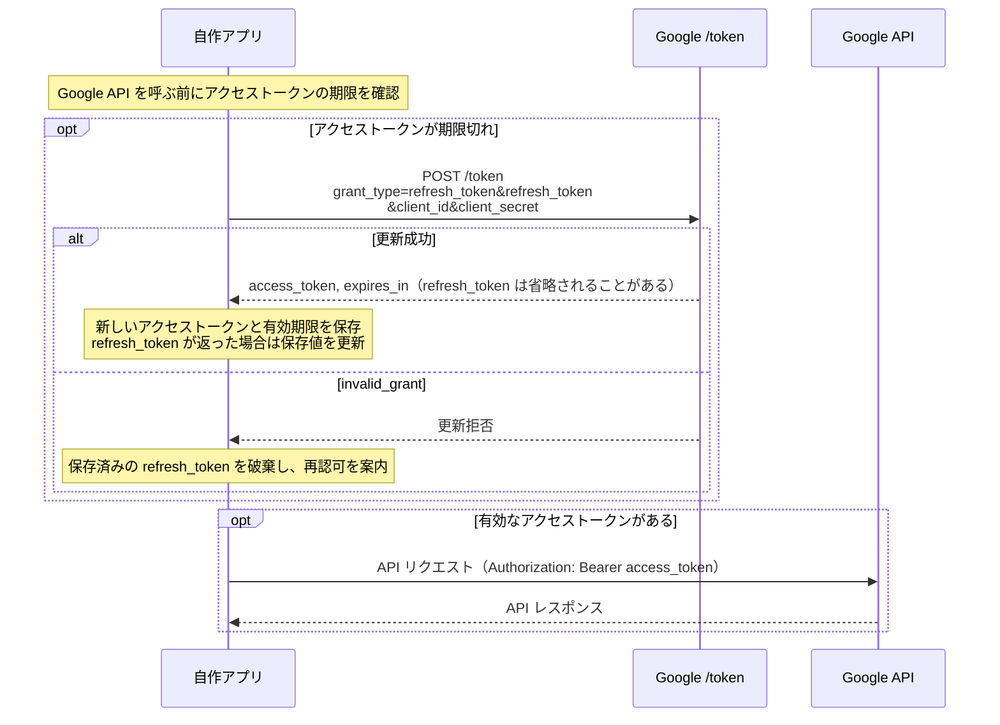

# study-Auth — OAuth 2.0 / OpenID Connect をライブラリ無しで理解する

「Google アカウントでログインすると、自分のプロフィール画面にメールアドレスと名前を表示する Web アプリ」を
Go で OAuth ライブラリを使わずに作り、OAuth 2.0 (Authorization Code Flow + PKCE) と OIDC の各ステップを
ブラウザの Network タブとサーバーログで確認する。

## ローカルで動かす

`state` の動作確認には `.env.example` のダミー値を使える。

Go 1.26.2 以上で、リポジトリのルートから実行する。

```sh
cp -n .env.example .env
make run
```

1. ブラウザで `http://localhost:8080` を開き、「Google でログイン」をクリックする。
2. `/login` の本文に表示された `state=...` をコピーする。開発者ツールの Network タブでは、レスポンスの `Set-Cookie` に `sid`、`HttpOnly`、`SameSite=Lax` が含まれることを確認できる。
3. 同じブラウザで `http://localhost:8080/callback?state=...` を開く。`...` をコピーした値に置き換えると、`200 OK` と本文の `state OK` が返る。
4. 同じ URL を再読み込みすると、使用済みの state は `400 Bad Request` で拒否される。新しい `/login` で発行した state を別の値に変えた場合や、`sid` を持たないブラウザでアクセスした場合も `400` が返る。

`make test` は `go test ./...` を実行する。現時点ではテストファイルがないため、ビルドの確認に使う。

## 最終的なアウトプット（全体像）

ブラウザ・自作アプリ・Google の間の通信を、初回ログインとログイン後のトークン更新に分けて示す。図中の `[Step N]` は README 下部のステップに対応する。

### Google ログインとプロフィール表示



### ログイン後のアクセストークン更新（Step 8 の実装予定）

Step 8 では、上の図の `/login` が返す Google の認可 URL に `access_type=offline` を付ける。認可コード交換のレスポンスに `refresh_token` が含まれていれば、ログインの検証を終えてからGoogle の `sub` ごとにサーバ側メモリへ保存する。同じユーザーの保存済みの値は、レスポンスで省略された場合も保持する。

下の図は、ログイン後に自作アプリが Google API を呼ぶ場合の流れ。`/profile` はセッションに保存した名前とメールアドレスを表示するため、表示時にトークンを更新する必要はない。



### どこで何を観察するか

| 見る場所 | 観察できるもの | Step |
| --- | --- | --- |
| Network タブ: `/login` のレスポンス | 302 の `Location`（authorize URL の全パラメータ）、`Set-Cookie` | 1, 2, 3 |
| Network タブ: Google 内の遷移 | ログイン画面、同意画面、最後の `/callback` への 302 | 3 |
| Network タブ: `/callback` のリクエスト | URL に露出する `code` と `state`、送られる `Cookie` | 1, 4 |
| サーバーログ | `/token` への POST 本文とレスポンス JSON（ブラウザからは見えない） | 4 |
| サーバーログ | JWKS 取得、デコードした header / claims、検証結果 | 5 |
| サーバーログ | userinfo への Bearer 付き GET、HTTP ステータス、`sub` の照合結果 | 6 |
| ブラウザ: `/profile` | 名前とメールアドレス | 6 |
| Network タブ: `/login` のレスポンス | Google の認可 URL に付く `access_type=offline` | 8 |
| テスト / サーバーログ | 期限切れ時の `grant_type=refresh_token` による更新と、その後の Google API 呼び出し。ログではトークンとシークレットの値を伏せる | 8（予定） |

## 実装要件（縛り）

- OAuth ライブラリ禁止
- JWT デコードは自前（署名検証は crypto/rsa 等のライブラリ利用可）
- PKCE を自前実装
- state を自前実装
- Google の認可 URL（`https://accounts.google.com/o/oauth2/v2/auth`）を自前生成
- `/token` は `http.Client` で直接 POST
- userinfo を `Authorization: Bearer` 付きで直接呼ぶ
- ブラウザの Network タブとサーバーログで、各リクエスト・レスポンスを確認する

## 登場するエンドポイント（Google）

| 役割 | URL |
| --- | --- |
| Discovery | https://accounts.google.com/.well-known/openid-configuration |
| 認可 (authorize) | https://accounts.google.com/o/oauth2/v2/auth |
| トークン (token) | https://oauth2.googleapis.com/token |
| userinfo | https://openidconnect.googleapis.com/v1/userinfo |
| JWKS (公開鍵) | https://www.googleapis.com/oauth2/v3/certs |
| issuer | https://accounts.google.com |

## 進め方

各ステップで「仕様の要点」→「実装」→「Network タブ / ログで観察」の順に進める。
チェックを付けながら進める。

### Step 0: 準備

Google へのリダイレクトを試す段階で、以下の設定を行う。`REDIRECT_URI` は Google 側に登録した URI と完全に一致させる。

- [x] Google Cloud Console で OAuth 同意画面を設定（外部 / テストユーザーに自分を追加）
- [x] 「OAuth 2.0 クライアント ID（ウェブ アプリケーション）」を作成
- [x] 承認済みのリダイレクト URI に `http://localhost:8080/callback` を登録
- [x] `.env` に `GOOGLE_CLIENT_ID` / `GOOGLE_CLIENT_SECRET` / `REDIRECT_URI` を置く（`.env` は commit しない）
- [x] `go mod init` して `net/http` だけで `/` を返す最小サーバを起動する

観察: Discovery ドキュメントを開き、上の表の URL が載っていることを確認する。

### Step 1: セッションと state（CSRF 対策）

- [x] Cookie（`HttpOnly`, `SameSite=Lax`）+ サーバ側メモリでセッションを持つ
- [x] `/login` で `crypto/rand` から state を生成してセッションに保存する
- [x] `/callback` で返ってきた `state` とセッション内の値を照合する（定数時間比較、使い捨て）
  - [x] 一致する state とセッション Cookie で `200 OK` を返すことを確認
  - [x] 使用済みの state、不一致の state、セッション Cookie なしの各ケースで `400 Bad Request` を返すことを確認

理解したいこと: state が無いと何が起きるか（ログイン CSRF）。
`SameSite=Lax` でも Google からの戻り（トップレベル GET）で Cookie が送られるのはなぜか。

### Step 2: PKCE（認可コード横取り対策）

- [x] `code_verifier`（43〜128 文字の乱数）を生成してセッションに保存する
- [x] `code_challenge = BASE64URL(SHA256(code_verifier))` を計算する（パディング無し）
- [x] RFC 7636 Appendix B のテストベクタで単体テストを書く
  - verifier `dBjftJeZ4CVP-mB92K27uhbUJU1p1r_wW1gFWFOEjXk`
  - challenge `E9Melhoa2OwvFrEMTJguCHaoeK1t8URWbuGJSstw-cM`

理解したいことは、challenge を Google の認可エンドポイント（`/o/oauth2/v2/auth`）に、verifier をトークンエンドポイント（`/token`）に分けて送ると、なぜ安全になるのか。

### Step 3: Google の認可 URL（`/o/oauth2/v2/auth`）の自前生成

- [x] `url.Values` で以下を組み立てて 302 リダイレクトする
  - `client_id`, `redirect_uri`, `response_type=code`
  - `scope=openid email profile`
  - `state`, `nonce`
  - `code_challenge`, `code_challenge_method=S256`

観察（Network タブ）: `/login` の 302 の `Location` ヘッダ、Google 側での複数回のリダイレクト、
最後に `/callback?code=...&state=...` へ戻ってくるリクエスト。
`code` が URL に露出していることを確認する（だから PKCE が要る）。

### Step 4: /callback と /token（認可コード → トークン交換）

- [x] `error` パラメータが来た場合の表示（state の照合後）
- [x] state 照合（Step 1）
- [x] `http.Client` で `/token` に `application/x-www-form-urlencoded` で POST
  - `grant_type=authorization_code`, `code`, `redirect_uri`, `client_id`, `client_secret`, `code_verifier`
- [x] レスポンス JSON（`access_token`, `id_token`, `expires_in`, `scope`, `token_type`）を構造体に受ける
- [x] 送信リクエストと受信レスポンスをログで観察する（`httputil.DumpRequestOut` / `DumpResponse`）。フォームと成功時の JSON は認可コード、シークレット、verifier、トークンを伏せて表示する。

観察（サーバーログ）: ブラウザからは見えないサーバ間通信。Google が web クライアントでは PKCE ありでも
`client_secret` を要求することを確認する。

### Step 5: ID トークン（JWT）の自前デコードと検証

- [x] `.` で 3 分割し、header / payload を base64url → JSON でデコードする
- [x] `alg` が `RS256` 以外なら拒否する（`alg=none` 対策）
- [x] JWKS を取得し、header の `kid` に一致する鍵の `n`, `e` から `rsa.PublicKey` を組み立てる
- [x] `SHA256("header.payload")` に対して `rsa.VerifyPKCS1v15` で署名検証する
- [x] クレーム検証: `iss`, `aud`(= client_id), `exp`, `nonce`(= Step 3 で送った値)
- [x] 改ざんしたトークン・期限切れ・aud 不一致が弾かれる単体テストを書く

理解したいこと: 「デコードできる」と「検証済み」は別物。nonce が防ぐ攻撃は何か。

### Step 6: userinfo と /profile

- [x] `GET userinfo` を `Authorization: Bearer <access_token>` 付きで直接呼ぶ
- [x] ログイン完了時にセッション ID を再発行する（セッション固定攻撃対策）
- [x] `/profile` に名前とメールアドレスを表示する
- [x] `POST /logout` でセッションを破棄する

観察: ID トークンの claims と userinfo の内容を見比べる。両方に `email`, `name` があるが役割は何が違うか。

### Step 7: 振り返り

- [x] state / PKCE / nonce がそれぞれどの攻撃を防ぐかを自分の言葉で書く
- [x] Implicit Flow（`response_type=token`）が非推奨になった理由を説明できる
- [x] 本番で追加で必要になること（JWKS キャッシュ、セッションの永続化、HTTPS/`Secure` Cookie、refresh_token）を列挙する

### Step 8: refresh_token でアクセストークンを更新する

Google API をログイン後も呼ぶ場合に備えて、アクセストークンを更新する流れを実装する。アプリのログイン状態は Step 6 のセッションで管理する。

- [x] `/login` の `handleLogin` で Google の認可 URL に `access_type=offline` を追加する
- [x] 認可コード交換時の `tokenResponse` に `refresh_token` を追加し、検証済みのログインに紐づけてサーバ側に保存する。Google が返さない場合は、同じユーザーの保存済みトークンがあれば保持する
- [x] Google の `/token` に `grant_type=refresh_token`, `refresh_token`, `client_id`, `client_secret` をフォームで POST し、新しい `access_token` と `expires_in` を受け取る
- [ ] `expires_in` からアクセストークンの有効期限を管理し、Google API を呼ぶときに期限切れなら更新する。更新レスポンスに新しい `refresh_token` があれば保存し直す
- [ ] `invalid_grant` で更新を拒否されたら保存済みの `refresh_token` を破棄し、Google API を再び使うための認可フローを案内する。一時的な通信エラーの場合は保存済みの値を保持する
- [ ] テーブル駆動テストで、更新成功、`refresh_token` が省略された場合、更新拒否、一時的な通信エラーを確認する

観察（Network タブ / サーバーログ）: `/login` の `Location` に `access_type=offline` が付くことを確認する。テストでアクセストークンを期限切れにし、Google API の呼び出し前にサーバ側から `grant_type=refresh_token` のリクエストが送られることを確認する。ログを使う場合は各トークンと `client_secret` の値を伏せる。

## 参考仕様

- RFC 6749: The OAuth 2.0 Authorization Framework
- RFC 7636: Proof Key for Code Exchange (PKCE)
- RFC 7519: JSON Web Token (JWT) / RFC 7517: JSON Web Key (JWK)
- OpenID Connect Core 1.0（特に §3.1.3.7 ID Token Validation）
- Google: https://developers.google.com/identity/openid-connect/openid-connect
