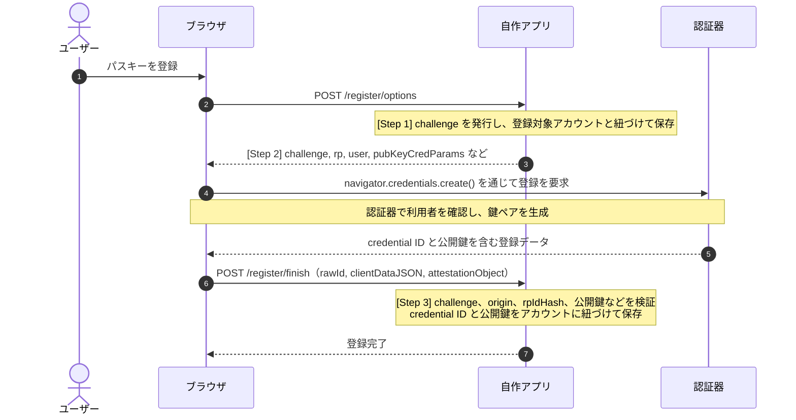
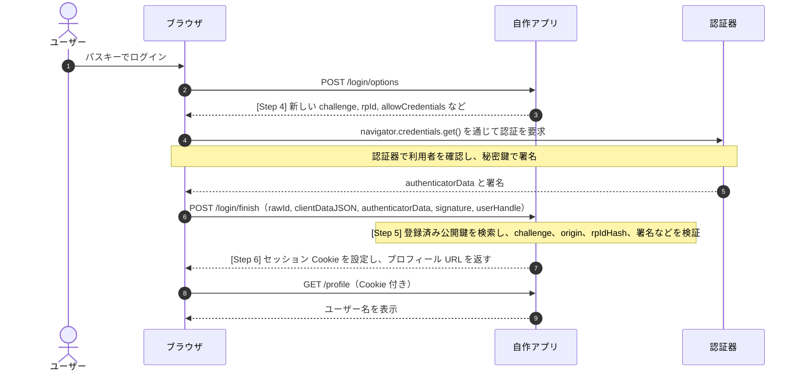

# study-Auth — WebAuthn をライブラリ無しで理解する

「パスキーを登録し、そのパスキーで同じアカウントにログインして、プロフィールにユーザー名を表示する Web アプリ」を Go で作る。登録時に保存した公開鍵でログイン時の署名を検証し、challenge、origin、RP ID がそれぞれ何を保証するかをブラウザの Network タブとサーバーログで確認する。

## ローカルで動かす

Step 0 の最小サーバーを起動するには、Go 1.26.2 以上でリポジトリのルートから実行する。

```sh
go run ./webauthn
```

ブラウザで `http://localhost:8081` を開くと「パスキーを作成」ボタンが表示される。WebAuthn はセキュアコンテキストで利用でき、ローカル開発では `http://localhost` を使える。この課題では期待する origin を `http://localhost:8081`、RP ID を `localhost` に固定する。アクセスする URL もこの設定にそろえる。リポジトリの `make run` は OIDC 用で、`make test` はリポジトリ全体の Go テストを実行する。

Step 6 までの実装後は、学習用の固定アカウントで「パスキーを登録」を選び、認証器の案内に従う。続けて「パスキーでログイン」を選び、プロフィールが表示されることを確認する。端末のパスキーが使えない場合は、ブラウザの開発者ツールが提供する仮想認証器でも試せる。

## 最終的なアウトプット（全体像）

RP（Relying Party）は自作アプリ。認証器は鍵ペアを生成し、利用者の操作を受けて秘密鍵で署名する。アプリは公開鍵と credential ID をアカウントに紐づけて保存する。図中の Step は下の実装手順に対応する。

### パスキー登録



### パスキーでログイン



### どこで何を観察するか

| 見る場所 | 観察できるもの | Step |
| --- | --- | --- |
| Network タブの `POST /register/options` | challenge、RP ID、user handle、対応する署名アルゴリズム | 1, 2 |
| Network タブの `POST /register/finish` | credential ID、base64url で運ばれる `clientDataJSON` と `attestationObject` | 2, 3 |
| サーバーログ | `clientDataJSON.type` と origin、`rpIdHash` と UP / UV フラグの検証結果 | 3, 5 |
| Network タブの `POST /login/options` と `POST /login/finish` | ログインごとに変わる challenge、登録済み credential ID、認証時の署名 | 4, 5 |
| Network タブの `POST /login/finish` と `GET /profile` | 検証成功時の `Set-Cookie` と、Cookie を使ったプロフィール取得 | 6 |
| テスト | challenge の期限切れや再送、origin / RP ID の不一致、署名不一致での拒否 | 7 |

## 実装要件（縛り）

- WebAuthn のサーバーライブラリを使わず、Go でオプション生成とレスポンス検証を書く。CBOR のデコードには汎用ライブラリを使ってよい。署名検証には `crypto/ecdsa` などの Go 標準ライブラリを使う
- ブラウザは標準の Credential Management API を使う。HTTP の JSON ではバイナリ値をパディングなしの base64url で運び、API に渡すときにバイト列へ戻す
- 初回はローカル専用の固定アカウント、サーバー側メモリ保存、ES256（P-256 と SHA-256）、`attestation: "none"` で進める
- ログには検証した項目と結果を出し、セッション Cookie の値は伏せる

## 進め方

各ステップで「仕様の要点 → 実装 → Network タブ / ログで観察」の順に進める。

### Step 0 — 準備

- [x] 既存の Go モジュール内の `webauthn/` に `net/http` で `/` を返すサーバーを作る
- [x] 固定アカウント `demo` に安定したランダムな user handle（`user.id` に使う最大 64 バイトの識別子）を割り当てる。一度生成した 32 バイトの乱数をパディングなしの base64url で保持し、サーバー再起動後も同じ値を使う
- [x] ブラウザで `window.isSecureContext` と `window.PublicKeyCredential` を確認する

`http://localhost:8081/` を開き、開発者ツールの Console で `window.isSecureContext` が `true`、`typeof window.PublicKeyCredential` が `"function"` になることを確認する。

### Step 1 — セッションと challenge

- [x] `crypto/rand` で 32 バイトの challenge を生成し、操作種別、対象アカウント、有効期限とともにサーバー側のセッションに保存する
- [x] Cookie に `HttpOnly`、`SameSite=Lax` を付ける。Go サーバーが HTTPS リクエストを直接受けた場合は `Secure` も付ける
- [x] `finish` 側で対象セッションから有効な challenge を一度だけ取得できるようにする。取得と消費を同じロック内で行う

理解したいことは、署名を正しく検証できても、古いログイン応答の再送を拒むには毎回新しい challenge が必要な理由。

この段階では `curl -i -X POST http://localhost:8081/register/options` で、JSON の `challenge` と `Set-Cookie` を確認できる。Cookie にはセッション ID が入り、challenge は登録操作と `demo` の user handle に紐づけてサーバー側メモリに 5 分間保存する。有効なセッションで再度発行すると、前の challenge を置き換える。

ローカル HTTP のレスポンスでは `Set-Cookie` に `HttpOnly` と `SameSite=Lax` が付くことを確認する。

Step 1 の時点では、`/register/options` が発行した Cookie を付けて `POST /register/finish` を呼ぶと、初回は challenge を消費して `204 No Content`、再送では `400 Bad Request` が返る。Step 3 では `204` を返す前に登録レスポンスも検証する。

### Step 2 — 登録オプションとブラウザ API

- [x] `POST /register/options` で `rp`、`user`、`challenge`、`pubKeyCredParams`（`alg: -7`）を返す
- [x] `authenticatorSelection` で `residentKey: "required"` と `userVerification: "required"` を指定する。登録済み ID は `excludeCredentials` に入れる
- [x] `challenge`、`user.id`、`excludeCredentials[].id` をバイト列に変換し、`navigator.credentials.create({ publicKey })` を呼ぶ
- [x] `rawId`、`clientDataJSON`、`attestationObject` を base64url で `POST /register/finish` に送る。認証器の操作がキャンセルされたら画面に結果を表示する

現在は `curl -sS -X POST http://localhost:8081/register/options` で、`rp.id` が `localhost`、`user.name` が `demo`、`pubKeyCredParams` が `[{"type":"public-key","alg":-7}]` になることを確認できる。`challenge` と `user.id` はパディングなしの base64url で返る。

`authenticatorSelection` で、認証器がアカウントを選べる資格情報と、PIN や生体認証などによるユーザー確認を要求する。`excludeCredentials` には同じアカウントの登録済み credential ID が入る。登録データを保存する Step 3 までは、起動したサーバーは空配列を返す。

「パスキーを作成」を押すと、Network タブの `/register/options` のレスポンスに base64url の値が表示される。ブラウザはそれを `Uint8Array` に変換してから認証器に作成を要求する。作成後は `/register/finish` の Payload に `rawId`、`response.clientDataJSON`、`response.attestationObject` が表示される。base64url をデコードした `clientDataJSON` の `challenge` を発行値と見比べる。認証器の操作をキャンセルすると、画面に案内が表示される。

### Step 3 — 登録レスポンスの検証と公開鍵の保存

- [x] `clientDataJSON` を読み、`type == "webauthn.create"`、challenge、origin を照合する。この課題ではクロスオリジンの呼び出しを拒否する
- [x] CBOR の `attestationObject` を読み、`fmt == "none"`、空の `attStmt` を確認する。この方針で受け入れたデータから認証器の機種や信頼性は判定できない
- [x] `authData` を解析し、`rpIdHash == SHA256(RP ID)`、UP（User Present）、UV（User Verified）、AT（Attested Credential Data）を確認する
- [x] 埋め込まれた credential ID と `rawId` の一致を確認する。COSE_Key の鍵種別・アルゴリズム・曲線と点の座標を検証し、P-256 の公開鍵として扱う
- [ ] credential ID の重複を拒否し、検証済みの ID、公開鍵、署名カウンター、バックアップ適格性を登録対象アカウントと紐づけて保存する

理解したいことは、`origin` がスキームとポートを含むページの出所を表し、`rpIdHash` が認証器の資格情報のスコープを表す点。

Network タブで `/register/finish` のステータスを確認する。`authData` の先頭 32 バイトが `SHA256("localhost")` と一致し、次の 1 バイトに UP・UV・AT が立っていることを確認する。続けて、認証器データ内の credential ID を `rawId` とバイト単位で照合し、COSE_Key を EC2・ES256・P-256 の公開鍵として読み取る。点が曲線上にない場合や照合に失敗した場合は `400 Bad Request` が返る。現在の `204 No Content` はここまでの検証が成功したことを示し、公開鍵の保存は次の項目で行う。

### Step 4 — 認証オプションと assertion の取得

- [ ] `POST /login/options` で新しい challenge、`rpId`、対象アカウントの credential ID を含む `allowCredentials`、`userVerification: "required"` を返す
- [ ] `challenge` と `allowCredentials[].id` をバイト列に変換し、`navigator.credentials.get({ publicKey })` を呼ぶ
- [ ] `rawId`、`clientDataJSON`、`authenticatorData`、`signature`、返された場合は `userHandle` を base64url で `POST /login/finish` に送る

観察では、登録時と同じ credential ID が使われ、ログインのたびに新しい challenge と署名が返ることを確認する。

### Step 5 — assertion と署名の検証

- [ ] `rawId` が対象アカウントに属し、今回の `allowCredentials` に含まれることを確認する。`userHandle` が返った場合は保存済みの値と照合する
- [ ] `type == "webauthn.get"`、challenge、origin、クロスオリジンでないこと、`rpIdHash`、UP、UV を確認する。登録時とバックアップ適格性が一致することも確認する
- [ ] 受信した生の `clientDataJSON` バイト列をハッシュし、`authenticatorData || SHA256(clientDataJSON)` を署名対象として組み立てる。ES256 ではその SHA-256 ダイジェストと登録済み公開鍵を使い、`ecdsa.VerifyASN1` で署名を検証する
- [ ] 署名検証後に `signCount` を確認する。受信値が保存値より大きければ保存値を更新する。両方が 0 の場合はカウンターによる判定を行わない。それ以外で受信値が増えていない場合は異常のシグナルとして記録し、保存値を維持する

理解したいことは、challenge と origin を含む `clientDataJSON` のハッシュと、RP ID を含む `authenticatorData` が、ひとつの署名で結び付けられる仕組み。

### Step 6 — セッションとプロフィール

- [ ] 検証成功時にセッション ID を再発行し、認証済みアカウントを紐づける
- [ ] `GET /profile` は認証済みセッションのユーザー名を表示し、未ログインならトップページへ戻す
- [ ] `POST /logout` でセッションを破棄し、Cookie を削除する。ログアウト後に同じパスキーでログインできることを確認する

### Step 7 — テストと振り返り

- [ ] 登録とログインの成功例に加え、期限切れ・再送・別セッション・別操作の challenge が拒否されることをテストする
- [ ] origin / RP ID の不一致、UV がない応答、未知の credential ID、アカウントの不一致、署名不一致を拒否することをテストする
- [ ] challenge、origin、RP ID、署名検証がそれぞれどんな役割を担うかを説明する
- [ ] `allowCredentials` を省いたログインでは、返された credential ID と user handle でアカウントをどう特定・照合するかを考える

## 参考仕様

- [W3C Web Authentication Level 3 §6.1 — Authenticator Data](https://www.w3.org/TR/webauthn-3/#sctn-authenticator-data)
- [W3C Web Authentication Level 3 §7.1 — Registering a New Credential](https://www.w3.org/TR/webauthn-3/#sctn-registering-a-new-credential)
- [W3C Web Authentication Level 3 §7.2 — Verifying an Authentication Assertion](https://www.w3.org/TR/webauthn-3/#sctn-verifying-assertion)
